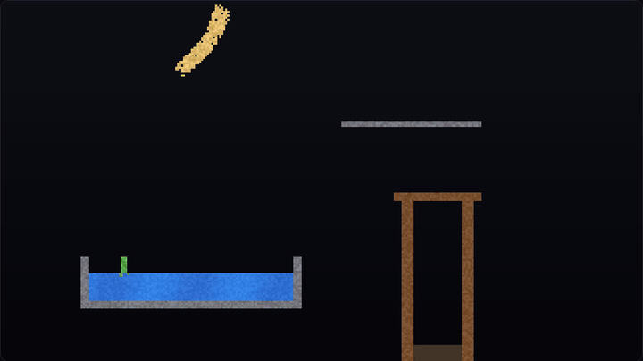

# Falling Sand

A falling-sand playground in a single HTML file. Draw sand, water, fire, lava, oil, acid, plants and more, and watch them react to each other.

**▶ Play it: [jessyroest.github.io/falling-sand](https://jessyroest.github.io/falling-sand/)**

## What happens when things touch

| | |
|---|---|
| Fire + wood / oil / plants | it spreads and leaves smoke |
| Lava + water | the lava cools into stone, the water turns to steam |
| Steam | rises and condenses back into water |
| Plants + water | plants grow into the water |
| Acid | eats almost everything, slowly even stone |

Heavier stuff sinks through lighter stuff: sand sinks in water, water sinks below oil.

## How it works

The world is a 320×180 grid of cells. Every frame, each cell is updated from the bottom up by a small rule for its element (powders fall, liquids flow sideways, gases rise, fire burns out). This is a classic **cellular automaton**. A per-cell clock makes sure a grain only moves once per frame, and the scan direction alternates every frame so liquids don't drift to one side.

Rendering writes straight into a `Uint32Array` behind an `ImageData`, so the whole thing runs at 60 fps without WebGL.

## Controls

`1`–`0` pick an element · `E` eraser · right-click erases · `Space` pause · `C` clear

No build step, no libraries: open `index.html` in a browser.
